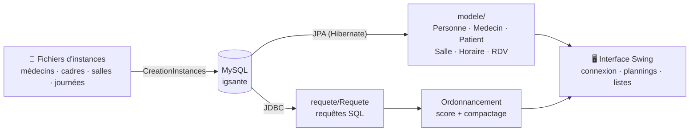

<h1 align="center">🏥 IG Santé</h1>

<p align="center">
  <strong>Application de bureau pour planifier les rendez-vous d'un centre médical :<br/>
  plannings par médecin et par salle, et réorganisation automatique des journées.</strong>
</p>

<p align="center">
  
  
  
  
  
  
</p>

---

Un centre médical reçoit chaque jour des dizaines de patients, répartis entre plusieurs médecins et plusieurs salles.
IG Santé charge ces rendez-vous dans une base MySQL, affiche les plannings, puis **cherche à réduire les trous dans
la journée des médecins et leurs changements de salle**.

## ✨ Fonctionnalités

- **🔐 Connexion par rôle** : un *cadre* (gestionnaire du centre) voit tout ; un *médecin* voit son propre planning.
- **📅 Plannings** : vue globale, vue par médecin et vue par salle, jour par jour.
- **👩‍⚕️ Annuaires** : liste des médecins et des salles.
- **🧮 Score de planning** : pour chaque médecin, on compte les **trous** (heures vides entre deux rendez-vous),
  les **créneaux perdus** et les **déplacements** d'une salle à l'autre.
- **⏩ Ordonnancement** : quand un trou apparaît, l'application tente d'avancer le rendez-vous suivant d'une ou
  deux heures si la salle est libre, pour compacter la journée.
- **🗂️ Jeux de données** : 19 journées de rendez-vous fictives (novembre-décembre 2023) à importer en base.

## 🧠 Comment ça marche



- **Modèle** : les entités JPA utilisent l'héritage (`Personne` → `Medecin`, `Patient`, `Cadre`) dans une seule table.
- **Score d'un planning** = trous + créneaux vides + changements de salle. Plus il est bas, mieux la journée est organisée.

## 🚀 Démarrage rapide

### Prérequis

- Java 11 ou plus récent
- Un serveur MySQL local (base `igsante`, utilisateur `root` sans mot de passe par défaut)

### Installation

```bash
git clone https://github.com/DHoudetot-Cyril/IgSante.git
cd IgSante

# 1. Créer la base et les tables
mysql -u root -e "CREATE DATABASE igsante"
mysql -u root igsante < igsanteCreate.sql

# 2. Compiler
./mvnw compile
```

3. Importer les données d'exemple : lancer la classe `CreationInstances` (depuis l'IDE).
4. Lancer l'application : classe `vuecontrole.Connexion`.

> Les identifiants de connexion à la base se modifient dans `src/main/resources/META-INF/persistence.xml`
> et `src/main/java/requete/Requete.java`.

## 📁 Structure du projet

```text
src/main/java/
├── modele/              # entités JPA : Personne, Medecin, Patient, Cadre, Salle, Horaire, RDV
├── requete/Requete.java # accès JDBC à la base
├── vuecontrole/         # fenêtres Swing + Ordonnancement (score et compactage)
├── instances/           # jeux de données fictifs (médecins, salles, 19 journées)
└── CreationInstances.java   # import des instances en base
igsanteCreate.sql        # schéma de la base
```

## 🗺️ Pistes d'amélioration

- [ ] Remplacer l'heuristique par un vrai solveur d'optimisation (OR-Tools, programmation linéaire)
- [ ] Sortir la configuration de la base dans des variables d'environnement
- [ ] Ajouter des tests unitaires sur le calcul du score
- [ ] Lancer MySQL avec Docker Compose pour une installation en une commande

## 👤 Auteur

**Cyril D'Houdetot** · [GitHub](https://github.com/DHoudetot-Cyril)

<sub>Projet réalisé pendant mes études d'ingénieur. Toutes les personnes des jeux de données sont fictives.</sub>
